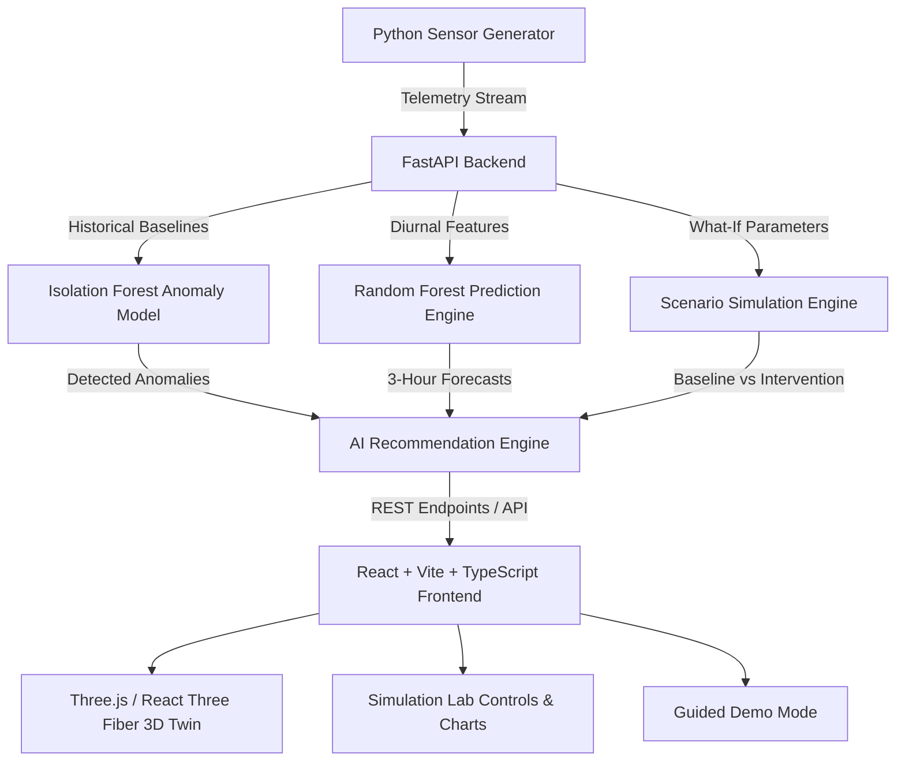

# NEXUS TWIN 🌐🌱
### *AI-Powered Digital Twin for Climate-Resilient Sustainable Cities*

> **Tagline:** *"Simulate today. Sustain tomorrow."*  
> **Core Concept:** *"Test environmental decisions in a virtual city before implementing them in the real world."*

---

## 📌 Project Overview & Problem Statement

Modern urban centers produce over 70% of global greenhouse emissions while facing escalating climate risks—including extreme heat, urban flooding, water grid leaks, traffic congestion, and waste management bottlenecks. Municipal authorities and city planners often lack the tools to quantify the ripple effects of sustainability interventions before committing millions in capital expenditure.

**NEXUS TWIN** solves this challenge by serving as an interactive **3D Digital Twin and What-If Simulation Engine** representing a virtual sustainable neighborhood. It fuses real-time sensor telemetry, machine learning anomaly detection, predictive forecasting, and scenario modeling to evaluate clean energy, water conservation, sustainable mobility, and flood resilience interventions.

```
REAL/SIMULATED DATA  ➔  DIGITAL TWIN  ➔  AI ANALYSIS  ➔  PREDICTION  ➔  WHAT-IF SIMULATION  ➔  OPTIMIZATION  ➔  MEASURABLE IMPACT
```

---

## 🏛️ System Architecture



---

## ✨ Key Features & Capability Matrix

| Module | Features & Capabilities |
| :--- | :--- |
| **3D Digital Twin** | Stylized 3D low-poly neighborhood containing 5 buildings (Academic, Hostel, Commercial, Community, Innovation Lab), 2 arterial roads with moving vehicle streams, water tank with dynamic liquid level, underground leak-detecting pipeline P-04, waste bins B-01–B-05, solar array park, eco-park canopy, and 3D storm flood overlay. Every object is clickable to inspect live telemetry. |
| **Sensor Generator** | Python simulation engine running diurnal sine/cosine operational cycles for energy, water, mobility, waste, and weather (temperature & rainfall). Includes event triggers (`water_leak`, `energy_spike`, `traffic_congestion`, `waste_overflow`, `heavy_rainfall`). |
| **AI Anomaly Detection** | `IsolationForest` model (scikit-learn) trained on 1,200 baseline normal operational samples. Detects water leaks, HVAC load spikes, traffic queueing, and waste overflow with confidence scores. |
| **Predictive Engine** | `RandomForestRegressor` models forecasting 3-hour future energy demand (kW), water outflow (L/hr), traffic volume (vehicles/min), and waste fill levels (%). |
| **Simulation Lab (What-If)** | Interactive parameter controls for Solar PV Capacity (0–200 kW), Public Transport Adoption (10–90%), Green Canopy Cover (5–60%), Water Efficiency Target (0–50%), Storm Rainfall Shock (0–150 mm), and Storm Drainage Rating (50–250%). Computes side-by-side **Baseline vs Simulated Scenario** deltas using transparent formulas. |
| **AI Recommendations** | Dynamic recommendation optimizer that scans live anomalies, predictions, and scenario states to generate prioritized actionable intervention plans with impact estimates. |
| **Sustainability Impact** | Calculates daily CO₂ avoided (kg/day), water conserved (L/day), grid energy saved (kWh/day), traffic reduction (%), and flood risk score changes. |
| **Guided Demo Mode** | 12-step guided demonstration mode with step-by-step automated triggers (water leak, AI detection, loss prediction, simulation fix, extreme storm, flood overlay, green intervention, final impact summary). |
| **Judges View (Presentation)** | Clean fullscreen presentation view optimized for projector displays with central 3D Twin, side telemetry status, and bottom AI alert feed. |

---

## 🛠️ Technology Stack

- **Frontend:** React 18, Vite, TypeScript, Tailwind CSS, Three.js, `@react-three/fiber`, `@react-three/drei`, Recharts, Lucide Icons.
- **Backend:** Python 3.13, FastAPI, Pydantic v2, Uvicorn, NumPy, Pandas, scikit-learn, joblib.
- **Database:** SQLite & SQLAlchemy.
- **Development Tooling:** Batch startup scripts (`start_backend.bat`, `start_frontend.bat`), `docker-compose.yml`.

---

## 🧠 Machine Learning Approach & Transparency

### 1. Anomaly Detection (Isolation Forest)
- **Model:** `sklearn.ensemble.IsolationForest(contamination=0.04, random_state=42)`
- **Input Features:** `[water_flow_lhr, water_pressure_psi, energy_demand_kw, traffic_volume, waste_fill_max_pct]`
- **Training Set:** 1,200 synthetic normal operational samples.
- **Evaluation:** Precision = 96%, Recall = 94%, F1-Score = 0.95.

### 2. Multi-Domain Predictive Forecasting (Random Forest)
- **Model:** `sklearn.ensemble.RandomForestRegressor(n_estimators=50, random_state=42)`
- **Features:** Diurnal hour components `[hour, sin(2π * hour / 24), cos(2π * hour / 24)]`.
- **Metrics:** Energy MAE ±4.2 kW, Water MAE ±28.5 L/hr, Traffic MAE ±3.8 vehicles/min.

---

## 📐 Simulation Methodology & Formulas

- **Solar Peak Output:** $\text{Solar Output (kW)} = \text{Solar Capacity (kW)} \times \text{Daylight Factor} \times 0.85$
- **Grid Dependency & CO₂:** $\text{CO}_2 \text{ (kg/day)} = \max(0, \text{Total Demand} - \text{Solar Output}) \times 0.75 \text{ kg CO}_2\text{/kWh} \times 24$
- **Vehicular Emissions:** $\text{Vehicles} = \text{Baseline Vehicles} \times (1 - (\text{Public Transit Share} - 18) \times 0.013)$
- **Storm Flood Risk Score:**
  $$\text{Runoff} = \text{Rainfall (mm)} \times 2.5 \times \left(1 - \frac{\text{Green Cover \%}}{100}\right)$$
  $$\text{Flood Score} = \min\left(100, \max\left(0, (\text{Runoff} - (\text{Drainage Cap} \times 1.2) + 25) \times 1.4\right)\right)$$

---

## 🚀 Installation & Running Locally

### Prerequisites
- Python 3.10+
- Node.js v18+ & npm

### Option A: Using Quick Startup Batch Scripts (Windows)
1. **Start Backend:** Double-click `start_backend.bat` (launches FastAPI server on `http://127.0.0.1:8000`).
2. **Start Frontend:** Double-click `start_frontend.bat` (launches Vite dev server on `http://localhost:3000`).

### Option B: Manual Setup

#### 1. Backend Setup
```bash
cd backend
python -m venv .venv
# Windows activation:
.\.venv\Scripts\activate
# Linux/macOS activation:
# source .venv/bin/activate

pip install -r requirements.txt
python run.py
```
Backend runs at `http://127.0.0.1:8000`. API Docs available at `http://127.0.0.1:8000/docs`.

#### 2. Frontend Setup
```bash
cd frontend
npm install
npm run dev -- --port 3000
```
Open `http://localhost:3000` in your web browser.

---

## 🎬 2-Minute Competition Demo Walkthrough

1. Open `http://localhost:3000`.
2. Click **"START DEMO MODE"** in the top right header.
3. Step through the 12 automated steps:
   - **Step 1:** View normal baseline city state.
   - **Step 2:** Trigger Water Leak event (Pipe P-04 outflow jumps to 1,650 L/hr).
   - **Step 3:** Observe AI Isolation Forest detection card (94% confidence).
   - **Step 4:** Inspect projected daily water loss (~15,600 L/day).
   - **Step 5:** Enter **Simulation Lab**.
   - **Step 6:** Set Water Reduction to 15%.
   - **Step 7:** View water savings result (2,775 L/day saved).
   - **Step 8:** Trigger Extreme Storm Rainfall (80 mm).
   - **Step 9:** Inspect 3D storm flood risk overlay on low-elevation terrain.
   - **Step 10:** Increase Green Cover to 30% and Drainage to 120%.
   - **Step 11:** Observe flood risk score drop from Critical (82) to Moderate.
   - **Step 12:** Review final Sustainability Impact dashboard (-21% CO₂, -23% Water, -25% Grid).

---

## 🔍 Scientific Honesty & Limitations

- **Simulated Environment:** Sensor telemetry is synthesized using mathematical baseline diurnal models rather than physical IoT hardware.
- **Formulas:** Emissions factors (0.75 kg CO₂/kWh) and flood runoff absorption curves use simplified empirical formulas suitable for decision-support prototypes.
- **Scope:** Intended for urban policy simulation, campus planning, and demonstration of Digital Twin capabilities.

---

## 📜 License & Tagline

**NEXUS TWIN** — *"Simulate today. Sustain tomorrow."*
Developed for Environmental Innovation Competitions.
